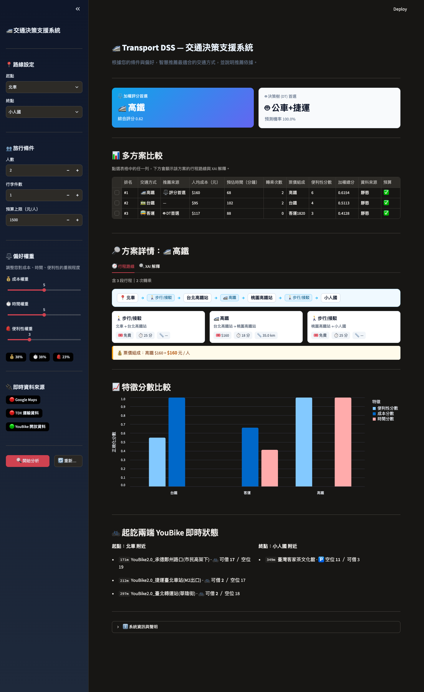
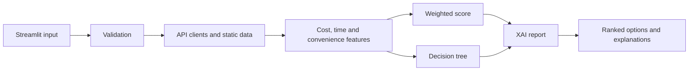

# Transport DSS: Explainable Transport Decision Support

A Streamlit decision support system that recommends how to travel between ten attractions in northern Taiwan, then explains why. It takes party size, luggage, budget and cost, time and convenience preferences, and ranks the available transport options.



## Highlights

- **Two independent recommenders:** a transparent weighted score that responds to user preferences, and a decision tree trained on scenario data.
- **Explanations:** weighted contribution breakdown, the tree's IF-THEN path, SHAP feature pushes and counterfactual hints.
- **Live data with fallback:** Google Maps, TDX and YouBike clients with layered caching. The app still runs without API keys by falling back to static tables.
- **Tested:** 173 pytest tests cover the data layer, features, models, explanations and integration flow.



## Model limits

- The decision tree reports about 92% accuracy on a binary best / not-best label. That figure comes from **synthetic passenger scenarios** generated over real route data, so it does not measure real-world traveler satisfaction.
- Coverage is limited to ten attractions; arbitrary origins and destinations are not supported.
- Without API keys, some routes offer fewer transport options because they rely on static tables.

## Run it

```bash
python3 -m venv .venv
source .venv/bin/activate
pip install -r requirements.txt
cp .env.example .env    # optional: add API keys
streamlit run ui/app.py
```

Trained model files live in `data/ml/`, which is not tracked in Git. Without them the app shows only the weighted score, and five tests that need the model fail. See [docs/colab.md](docs/colab.md) to train the model. With those files in place, `pytest` passes all 173 tests.

## Team

A three-person university final project. By commit history, [@D-ch-e](https://github.com/D-ch-e) built the Streamlit UI, data and API clients, configuration and services, and [@plsdontrunaway](https://github.com/plsdontrunaway) built the scoring model and decision-tree module. Work done outside Git is not reflected here.

---

# Transport DSS — 可解釋交通決策支援系統

> 模型說明：決策樹約 92% 的準確率是以**合成乘客情境資料**訓練與評估的二元分類（最佳／非最佳）結果，不代表真實使用者的滿意度。訓練好的模型檔位於未納入 Git 的 `data/ml/`。

針對北北基桃地區景點旅遊情境設計的交通推薦決策支援系統，整合即時 API 資料、機器學習模型與可解釋 AI 技術，協助使用者在多種交通方式中做出最適選擇。

---

## 系統功能

- **交通方式推薦**：根據起訖地、人數、行李量、預算與時間偏好，從高鐵、台鐵、客運、捷運、計程車等多種交通方式中推薦最佳選項
- **即時資料整合**：串接 Google Maps API、TDX 運輸資料、YouBike API；無 API 金鑰時自動切換為靜態資料 fallback
- **可解釋 AI（XAI）**：提供加權貢獻分解、決策樹 IF-THEN 決策路徑、SHAP 特徵推力、反事實提示
- **互動式 UI**：Streamlit 介面，支援成本/時間/便利性偏好權重調整與即時重新計算

---

## 技術架構

```text
使用者輸入（Streamlit UI）
        ↓
輸入驗證（input_validator.py）
        ↓
資料整合（api_client.py ← Google Maps / TDX / YouBike API，靜態 CSV fallback）
        ↓
特徵計算（feature_engineer.py → cost / time / convenience）
        ↓
決策模型（scoring_model.py 加權評分 + decision_tree.py 決策樹分類）
        ↓
XAI 解釋（xai/report.py → 貢獻分解 + 決策路徑 + SHAP + 反事實）
        ↓
結果輸出（Streamlit UI）
```

---

## 專案結構

```text
transport-dss/
├── config/
│   └── settings.py            # 環境變數與全域設定（API 金鑰、快取 TTL）
│
├── data/
│   ├── api_client.py          # 外部 API 串接 + 分層快取
│   ├── input_validator.py     # 使用者輸入驗證
│   ├── clients/
│   │   ├── google_client.py   # Google Maps Directions API
│   │   ├── tdx_client.py      # TDX 運輸資料平台 API
│   │   └── youbike_client.py  # YouBike 站點即時資料
│   └── static/                # 靜態參考資料（票價表、座標、路由表）
│
├── features/
│   └── feature_engineer.py    # cost / time / convenience 特徵計算與正規化
│
├── models/
│   ├── scoring_model.py       # 加權評分模型
│   └── decision_tree.py       # 決策樹分類模型（92% 準確率，29 特徵）
│
├── services/
│   ├── route_planner.py       # 多模態路線規劃主邏輯
│   ├── multimodal.py          # 多段接駁組合
│   └── transfer_planner.py    # 轉乘計算
│
├── xai/
│   └── report.py              # XAI 解釋報告（加權分解 + 決策路徑 + SHAP + 反事實）
│
├── ui/
│   └── app.py                 # Streamlit 主介面
│
├── tests/                     # 單元測試與整合測試
├── scripts/                   # 資料前處理工具腳本
├── docs/                      # 架構文件
├── .env.example               # API 金鑰設定範本
├── requirements.txt
└── pytest.ini
```

---

## 安裝與設定

### 1. 安裝套件

```bash
pip install -r requirements.txt
```

### 2. 設定 API 金鑰（選用）

複製範本並填入金鑰：

```bash
cp .env.example .env
```

```env
GOOGLE_MAPS_API_KEY=your_google_maps_api_key
TDX_CLIENT_ID=your_tdx_client_id
TDX_CLIENT_SECRET=your_tdx_client_secret
```

> 無 API 金鑰時系統仍可執行，自動使用靜態 CSV 資料作為 fallback。

---

## 執行方式

```bash
streamlit run ui/app.py
```

### 執行測試

```bash
pytest
```

---

## 模型訓練（Google Colab）

決策樹模型的訓練資料蒐集與訓練流程在 Google Colab 上執行，完整步驟請參考 [docs/colab.md](docs/colab.md)。

簡述流程：

```text
Step 1  蒐集交通路線資料（Google Maps API）→ taiwan_route_dataset.csv
Step 2  生成乘客情境資料 → synthetic_real_model_data_ml.csv
Step 3  交通評分系統測試
Step 4  Decision Tree 模型訓練 → decision_tree_model.pkl、feature_columns.pkl
Step 5  使用者推薦測試
```

- 建議使用 Google Colab 執行，避免本機套件版本不一致。
- 使用路線蒐集功能前需自行申請 Google Maps API Key，並於 Colab Secrets 設定 `GOOGLE_MAPS_API_KEY`。
- 訓練產出的 `decision_tree_model.pkl` 與 `feature_columns.pkl` 為本系統 [decision_tree.py](models/decision_tree.py) 推論時使用的模型檔案。
- 訓練所需的目錄結構與資料可參考 [Google Drive 連結](https://drive.google.com/drive/folders/1OE42tzgXiJbVzUeXDQRQWMZpZRJRT7AC?usp=sharing)。

---

## 支援景點

北北基桃地區共 10 處景點：台北車站、台北 101、小人國、三峽老街、碧潭、陽明山竹子湖、桃園機場、基隆廟口夜市、木柵動物園、龍山寺。

---

## 使用的 API

| API                        | 用途                     | 無金鑰 fallback   |
| -------------------------- | ------------------------ | ----------------- |
| Google Maps Directions API | 即時行車時間、路線       | 靜態距離矩陣 CSV  |
| TDX 運輸資料平台           | 高鐵/台鐵/客運班表與票價 | 靜態票價 CSV      |
| YouBike API                | 站點即時可借車數         | 停用 YouBike 選項 |
